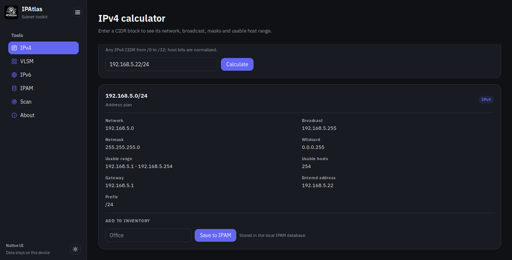
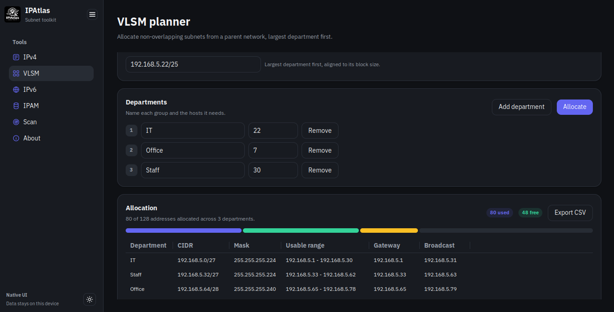
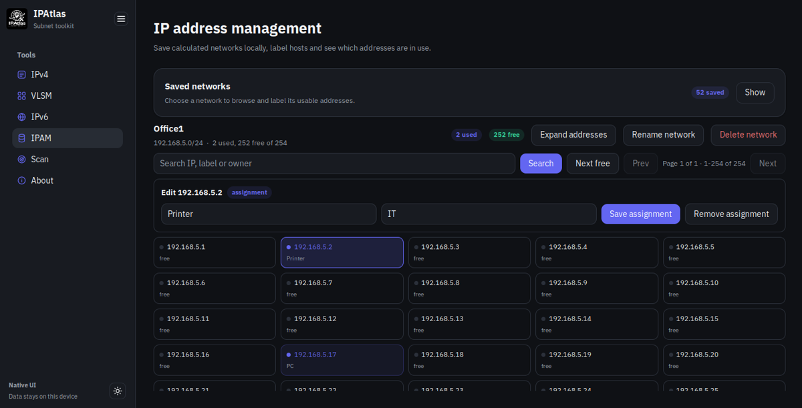
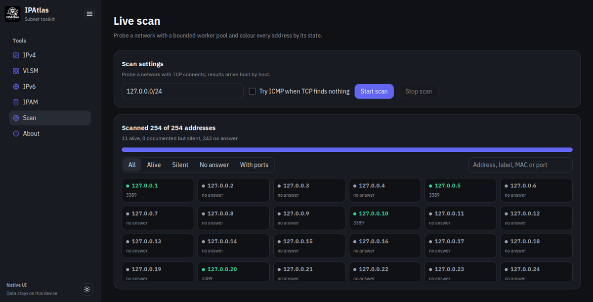

# IPAtlas

IPAtlas is a native desktop subnet calculator and IP address manager. It
combines IPv4 and IPv6 planning, VLSM allocation, a local IPAM database and a
live TCP host scanner in one window. The interface is drawn by
[MyGo](https://github.com/egoist/mygo) directly: there is no web view, HTML or
JavaScript. No data collection.


<table>
<tr>
<td width="50%">

</td>
<td width="50%">

</td>
</tr>
<tr>
<td width="50%">

</td>
<td width="50%">

</td>
</tr>
</table>


## Features

- **IPv4 calculator** — network, broadcast, netmask, wildcard, usable range,
  host count and gateway for any `/0`–`/32` CIDR, including `/31` and `/32`.
- **VLSM planner** — allocate departments largest first, with aligned,
  non-overlapping blocks, a proportional allocation bar and a results table.
- **IPv6 tools** — compress, expand and classify addresses; split a prefix
  page by page without materializing the full range.
- **IPAM** — save networks from the calculator, label and assign usable
  addresses, page through address grids, and keep everything in a local SQLite
  database.
- **Live scan** — probe TCP ports 80, 443, 22, 445 and 3389 with a bounded
  worker pool; update address states live; optionally try ICMP; read MAC
  addresses from the OS ARP table. Addresses already documented in IPAM are
  shown as **documented but silent** when they do not answer.


## Download

Prebuilt packages for Windows and Linux are on the [Releases page](https://github.com/mindfreq/ipatlas/releases).

## Requirements

- Go 1.27 or newer (the module uses Go 1.27).
- The platform requirements of MyGo 0.7.4 for native UI (a graphical session on
  Linux). See [MyGo](https://github.com/egoist/mygo)

## Build and run

```sh
go tool mygo dev
```

The IPAM database lives in MyGo's per-user data directory (for example
`~/.config/IPAtlas/ipatlas.db` on Linux; `mygo.App.Path(mygo.PathUserData)` on
other systems).

## Package

MyGo builds self-contained desktop artifacts without cgo:

```sh
go tool mygo build -platform linux/amd64
```

```sh
go tool mygo build -platform linux/amd64,windows/amd64,darwin/universal
```

## Test

```sh
go build ./...
go vet ./...
go test ./...
go test -race ./...
go tool mygo vet .
CGO_ENABLED=0 go test ./...
```

The tests cover the domain packages with table-driven cases and drive the UI
headlessly with `ui.NewTester`: calculator flows, validation messages, IPAM
persistence, IPv6 paging and a live scan against local listeners. No test
requires root, a real network or ICMP permission.

## Layout

| Path | Purpose |
|---|---|
| `main.go` | Window bootstrap, icon, app name and IPAM database lifecycle |
| `ui/` | MyGo native views and headless tester tests |
| `internal/netcalc` | IPv4 subnet math, VLSM allocation, IPv6 parsing/splitting |
| `internal/ipam` | SQLite schema, migrations, networks and assignments |
| `internal/scanner` | Bounded TCP scan, optional ICMP, ARP-table parsing |

## Scanner notes

- A scan is capped at 4096 usable addresses per run.
- A host is reported **alive** when any of these is true:
  - a probed TCP port accepts the connection (listed as open);
  - a probed TCP port refuses the connection (RST): the host answered, so it
    is alive with no open ports;
  - ICMP is enabled and the host answers `ping`;
  - the OS ARP table has a valid entry for the address after its probes.
- ICMP is optional and implemented by running the system `ping`; when the
  binary is missing or not permitted, the scan silently continues with TCP
  results.
- MAC addresses are read only from the operating system's ARP table
  (`/proc/net/arp` on Linux), once per host after its port probes, so the
  entries the probes themselves create are visible. The scanner never sends
  raw ARP packets.
- Only scan networks you are responsible for.

### Limitations

- Only five TCP ports are probed (80, 443, 22, 445, 3389). A host that
  filters all of them, does not answer ICMP and has no ARP entry is reported
  as not answering.
- Best results come from scanning your own local subnet. On routed networks,
  a firewall or proxy that answers with RST on behalf of every address can
  make unused addresses look alive.
- A host that just left the network may still show as alive for a few seconds
  while its ARP entry expires.
- MAC addresses and ARP-based detection are available on Linux only. On
  Windows and macOS the scanner relies on TCP (and optional ICMP) results.
- The IPAM stores IPv4 networks only.